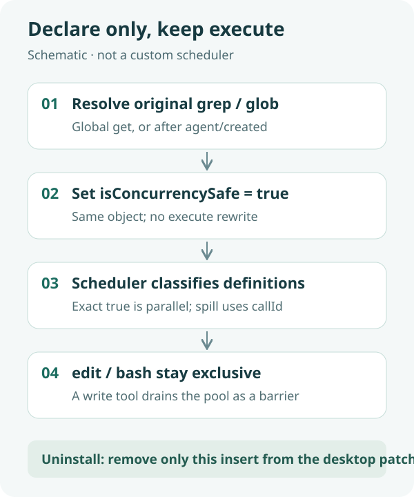

<div align="center">
  
  <h1>dsh-bingxing</h1>
  <p><strong>Let several grep / glob calls in one step actually overlap, without rewriting those tools.</strong></p>
  <p>A filesystem Host plugin for DeepSeek Harness Desktop.</p>
  <p><a href="README.md">简体中文</a> · <strong>English</strong></p>
  <p><a href="package.json">plugin 0.1.2</a> · Host-only ESM · no Client, no UI</p>
  <p><a href="#features">Features</a> · <a href="#how-it-works">How it works</a> · <a href="#quick-start">Quick start</a> · <a href="#configuration">Configuration</a> · <a href="#validation">Validation</a> · <a href="#faq">FAQ</a></p>
</div>

---

Stock `grep` and `glob` do not set `isConcurrencySafe`, so several calls in one step run exclusively. `read` and `web_search` already declare the flag. This plugin **only adds that flag on the original registered definition objects**, so the AGENTS.md rule about batching read-only calls also applies to search.

It does not rewrite grep/glob, invent its own ordering, or patch DSH core. Over-cap spill files (`grep-results.txt` / `glob-results.txt`) still come from the original `tools/post-execute` identity check. `bash`, `edit`, and `write` are never marked safe.

## Features

| Feature | Behavior |
|---|---|
| Patch the original object | `ctx.tools.get("grep")` / `get("glob")` returns the registered definition; set `isConcurrencySafe = () => true` |
| Scheduler sees it | Classification happens before `tools/execute`; only exact `true` is `parallel` |
| Spill unchanged | No replacement object, so post-execute still owns over-cap files |
| Writers stay exclusive | `edit` / `bash` stay undeclared; `grep, edit, grep` breaks at edit |
| Removable | Delete only this insert from the desktop patch; ⌘Q restores stock serial search |

## How it works



1. **Load**: the Desktop user patch inserts this plugin after built-in bundles.
2. **Find the original definitions**: try a global `get`; if grep/glob live on the preset scope, patch the agent-visible object on existing agents and `agent/created`. Each object is patched once.
3. **Schedule**: agent-loop reads `executionMode`. Several concurrency-safe calls in one step may overlap, up to `maxParallelToolCalls` (default 10).
4. **Barrier**: an undeclared tool stops new starts, drains the pool, then runs as the next exclusive group.
5. **Uninstall**: comment or delete this insert only; fully quit and reopen.

Dispose removes the property this plugin added. A hot unload is not a substitute for ⌘Q.

## Quick start

### 1. Prerequisites

- A running DeepSeek Harness Desktop.
- Verified environment: macOS, Desktop `0.2.1-alpha.4.20261020.1`. That is one installed build, not a compatibility promise for every build with a similar name.
- Git to clone. No extra npm dependencies at runtime. Windows, Linux, and other SDK builds are unverified.

### 2. Clone the plugin

The target directory should not already exist.

```sh
DSH_HOME="${DSH_HOME:-$HOME/.dsh}"
git clone https://github.com/yueyexiayu/dsh-bingxing.git "$DSH_HOME/plugins/dsh-bingxing"
```

### 3. Load it from the Desktop patch

**Merge** the following into the existing `$DSH_HOME/profiles/desktop/cordis.patch.yml`. Do not wipe other plugin rows. The path is relative to that patch file.

```yaml
- insert:
    - id: dsh-bingxing
      name: ../../plugins/dsh-bingxing/lib/index.js
```

The in-repo [bundle patch](cordis.patch.yml) uses a package-relative path and is not the Desktop profile path. Do not patch official DSH source, and do not use the CLI plugin manager to install into the desktop profile.

### 4. Start and check

Fully quit Desktop (macOS: ⌘Q) and reopen. Several `grep` or `glob` calls in one step should emit clustered `tool/call` events, not a strict call→result alternation. After uninstall, alternation should return.

## Configuration

There is no config file and no custom HTTP route. The Host inject list is `tools` and `agents`.

<details>
<summary><strong>Scope and coexistence</strong></summary>

grep/glob are registered by `@deepseek-ai/dsh-tool-fs-search` on the agent preset scope. A global `tools.get("grep")` may miss them; the plugin patches the same original object on `agent/created`.

Per-call timeouts still come from stock `dsh-tool-call-timeout-policy` and do not abort the whole step.

</details>

## Validation

On Desktop `0.2.1-alpha.4.20261020.1`:

- `ELECTRON_RUN_AS_NODE=1` `test/*.test.mjs`: 6 passing tests (declaration, object identity, duplicate register, serial without the plugin, overlap with it, exclusive edit/bash, over-cap spill, isolated failure, restore on dispose).
- Three Desktop ⌘Q cycles: parallel after mount, serial after uninstall, parallel again after restore. In one live step, six grep/glob `tool/call` events spanned 2–3ms, with a tool-pool of about 34ms.

Not verified on Windows/Linux or other Desktop versions. There is no GitHub Actions workflow; do not treat the local results as live CI.

```sh
cd "$DSH_HOME/plugins/dsh-bingxing"
/usr/local/bin/node --check lib/index.js
ELECTRON_RUN_AS_NODE=1 "/Applications/DeepSeek Harness.app/Contents/MacOS/DeepSeek Harness" --test test/*.test.mjs
```

## FAQ

**Why not register a second grep?**

Global `tools.register` rejects duplicate names. A new object also drops over-cap spill because post-execute checks object identity.

**Why not mark bash safe too?**

bash can write. This plugin only declares grep and glob.

**How do I uninstall?**

Comment or delete only the `id: dsh-bingxing` insert in desktop `cordis.patch.yml`, then ⌘Q. Do not empty the whole patch or remove other entries.

## Community and license

The public repository topic is `dsh-plugin`. Official DSH does not scrape GitHub automatically; community indexes scan that topic and still require a human check for full listing. This repository does not ship a license file.

<div align="center"><sub>Declare only, keep execute · <a href="README.md">阅读中文版 →</a></sub></div>
