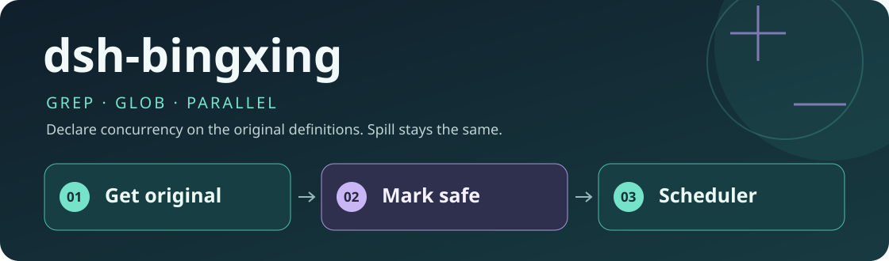
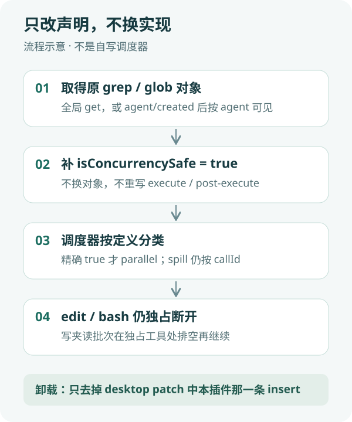

<div align="center">
  
  <h1>dsh-bingxing</h1>
  <p><strong>让同一步里的多个 grep / glob 真正并行，而不改它们的实现。</strong></p>
  <p>面向 DeepSeek Harness Desktop 的纯 Host 文件系统插件。</p>
  <p><strong>简体中文</strong> · <a href="README.en.md">English</a></p>
  <p><a href="package.json">插件 0.1.0</a> · 纯 Host / ESM · 无 Client、无 UI</p>
  <p><a href="#核心能力">核心能力</a> · <a href="#工作方式">工作方式</a> · <a href="#快速开始">快速开始</a> · <a href="#配置">配置</a> · <a href="#验证">验证</a> · <a href="#常见问题">常见问题</a></p>
</div>

---

现网 `grep` 和 `glob` 没有声明 `isConcurrencySafe`，同一步多个调用会被排成独占。`read`、`web_search` 等已经声明。这个插件**只给已注册的原定义对象补上并发声明**，让 AGENTS.md 里「多个只读调用放进同一步」对搜索工具也生效。

不重写 grep/glob，不自写顺序控制，不改 DSH 核心。超限 spill（`grep-results.txt` / `glob-results.txt`）仍由原 `tools/post-execute` 按对象身份写出。`bash`、`edit`、`write` 一律不声明。

## 核心能力

| 能力 | 具体行为 |
|---|---|
| 原对象补声明 | `ctx.tools.get("grep")` / `get("glob")` 拿到的就是注册时的定义；只设置 `isConcurrencySafe = () => true` |
| 调度器生效 | 分类发生在 `tools/execute` 之前；精确 `true` 才 `parallel` |
| 保持 spill | 不换对象，避免 post-execute 因身份变化跳过超限结果文件 |
| 写工具仍独占 | `edit` / `bash` 不声明；`grep、edit、grep` 在 edit 处断开 |
| 可卸载 | 去掉 desktop patch 中本插件那一条 insert，⌘Q 后恢复现网串行 |

## 工作方式



1. **加载**：Desktop 用户 patch 在内置 bundle 之后插入本插件。
2. **定位原定义**：先全局 `get`；grep/glob 若在 preset 作用域，则在已有 agent 和 `agent/created` 上按 agent 可见对象补声明。同一对象只补一次。
3. **调度**：agent-loop 读 `executionMode`；同一步多个并行安全调用可以重叠，且不超过 `maxParallelToolCalls`（默认 10）。
4. **屏障**：遇到未声明的工具就停止开新调用、排空后再把独占当下一组。
5. **卸载**：注释或删除本插件 insert，不动其他插件；完全退出后重开。

插件 dispose 时会删掉自己加上的属性。仅热卸载不够替代 ⌘Q。

## 快速开始

### 1. 前置条件

- 已安装并可运行 DeepSeek Harness Desktop。
- 已验证环境：macOS、Desktop `0.2.1-alpha.4.20261020.1`。这是具体本机安装构建，不是所有同名/其他版本的兼容承诺。
- Git 用于下载；运行源码不需要新的 npm 依赖。Windows、Linux 及其他 SDK 构建尚未验证。

### 2. 下载插件

目标目录应尚不存在；已有安装不要覆盖。

```sh
DSH_HOME="${DSH_HOME:-$HOME/.dsh}"
git clone https://github.com/yueyexiayu/dsh-bingxing.git "$DSH_HOME/plugins/dsh-bingxing"
```

### 3. 配置 Desktop 加载

将下面一项**合并**到现有 `$DSH_HOME/profiles/desktop/cordis.patch.yml`，不要覆盖其他插件配置。路径相对于这份 profile patch 文件。

```yaml
- insert:
    - id: dsh-bingxing
      name: ../../plugins/dsh-bingxing/lib/index.js
```

仓库内的 [bundle patch](cordis.patch.yml) 是包内相对路径，不能直接当作 profile 相对路径使用。无需改 DSH 官方源码，也不要用 CLI 插件管理器向 Desktop profile 安装依赖。

### 4. 启动与确认

完整退出 Desktop（macOS：⌘Q）后重新打开。同一步发出多个 `grep` 或 `glob` 时，会话里应看到多个 `tool/call` 先集中出现，而不是 call→result 严格交替。卸载后应恢复交替串行。

## 配置

本插件没有配置文件，也没有自定义 HTTP 路由。只注入 `tools` 和 `agents`。

<details>
<summary><strong>进阶：作用域与共存</strong></summary>

grep/glob 由 `@deepseek-ai/dsh-tool-fs-search` 在 agent preset 作用域注册。全局 `tools.get("grep")` 可能看不到它们；插件会在 `agent/created` 上补同一原对象。

与 `dsh-gongjuyasuo` 可同时挂载。gongjuyasuo 不改 `isConcurrencySafe`；并行后 inspect/recover 仍指向各次调用自己的 spill（按 `callId` 区分）。

单调用超时仍由官方 `dsh-tool-call-timeout-policy` 做成 per-call deadline，不中止整步。

</details>

## 验证

在已验证的 Desktop `0.2.1-alpha.4.20261020.1` 上：

- `ELECTRON_RUN_AS_NODE=1` 跑 `test/*.test.mjs`：6 项通过（声明、原对象身份、同名 register 失败、无插件串行、有插件重叠、edit/bash 独占、超限 spill、失败隔离、dispose 恢复）。
- Desktop 三次 ⌘Q：挂载后并行、卸载后串行、恢复挂载后再次并行。一次真实任务中，同一步 6 个 grep/glob 的 `tool/call` 跨度 2–3ms，工具池约 34ms。

未在 Windows/Linux 或其他 Desktop 版本上验证。没有 GitHub Actions；不要把上述本机结果当成实时 CI。

```sh
cd "$DSH_HOME/plugins/dsh-bingxing"
/usr/local/bin/node --check lib/index.js
ELECTRON_RUN_AS_NODE=1 "/Applications/DeepSeek Harness.app/Contents/MacOS/DeepSeek Harness" --test test/*.test.mjs
```

## 常见问题

**为什么不能重新 register 一个 grep？**

全局 `tools.register` 禁止同名。新对象还会让原 post-execute 因身份检查跳过 spill。

**为什么不把 bash 也标成并行安全？**

bash 可能写文件。本插件只声明 grep 和 glob。

**如何卸载？**

只注释或删除 desktop `cordis.patch.yml` 里 `id: dsh-bingxing` 那一条 insert，然后 ⌘Q。不要清空整个 patch，也不要删掉 `dsh-gongjuyasuo` 等其他条目。

## 社区与许可

公开仓库 Topic 为 `dsh-plugin`。官方 DSH 不会自动抓仓库；社区目录按该 Topic 扫描，进全量目录还需对方核实。本仓库未附带许可证文件。

<div align="center"><sub>只改声明，不换实现 · <a href="README.en.md">Read in English →</a></sub></div>
